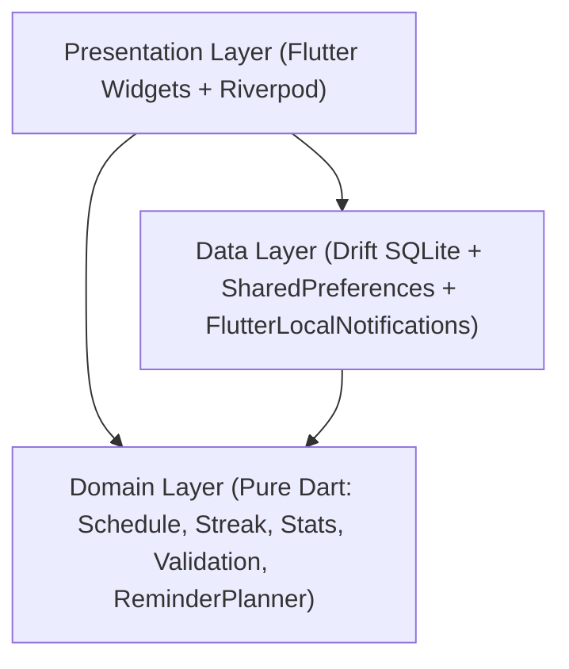
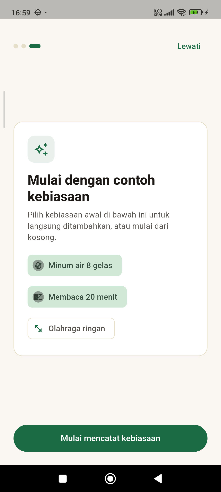
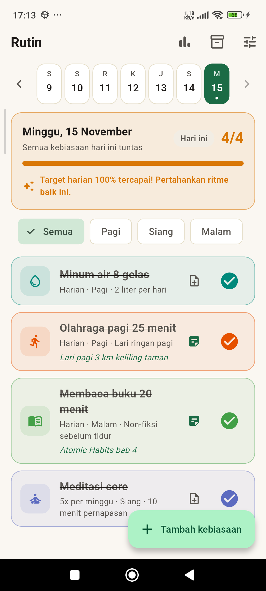
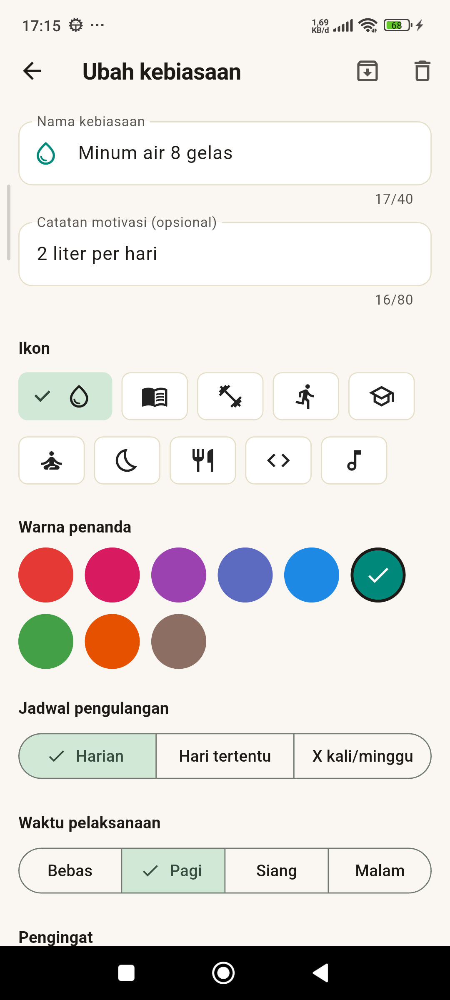
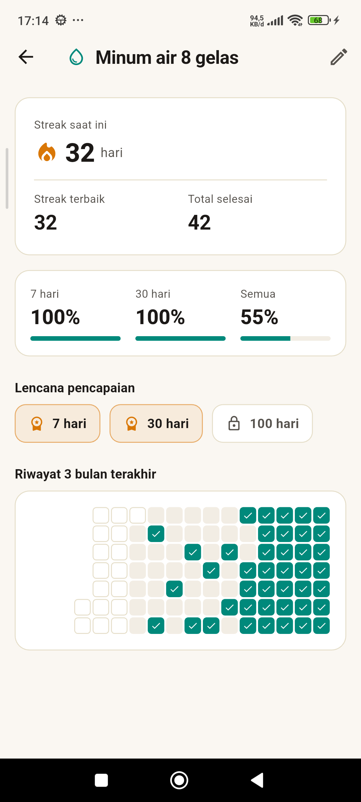
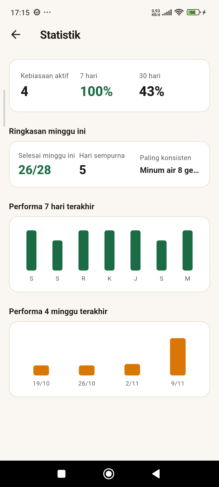
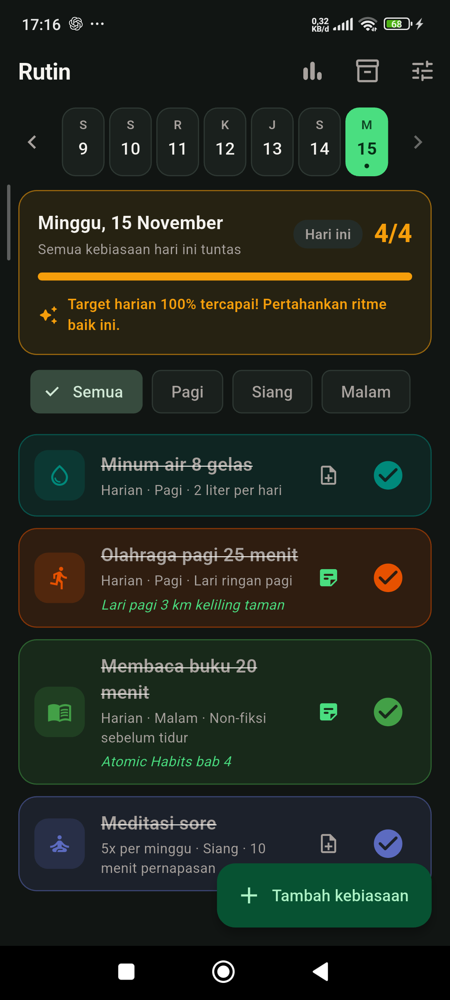

# Studi Kasus Portofolio: Aplikasi Habit Tracker "Rutin"

**Penulis:** Muhammad Al Khairan Asaad  
**Platform:** Android (API 26 / Android 8.0 ke atas)  
**Stack:** Flutter 3, Dart 3, Riverpod, Drift (SQLite), GoRouter, Material 3  
**Ukuran APK Rilis (`arm64-v8a`):** 21.6 MB (target PRD `< 30 MB`)  
**Waktu Cold Start (Perangkat Fisik Android 13):** 517 ms (target PRD `< 2000 ms`)  
**Pengujian Otomatis:** 89 pengujian lulus (`100%` cakupan baris pada domain logic)

---

## 1. Latar Belakang & Masalah

Banyak pelajar, mahasiswa, dan pekerja muda ingin membangun kebiasaan harian seperti minum air cukup, membaca, berolahraga, atau belajar teratur, tetapi berhenti di minggu-minggu awal karena empat hambatan utama:

1. **Alur pencatatan lambat:** membuka aplikasi, menunggu layar memuat akun, dan mencari menu membuat aktivitas mencatat terasa membebani.
2. **Kurangnya umpan balik visual yang jujur:** angka *streak* sering tidak transparan atau rusak ketika jadwal kebiasaan bukan harian penuh.
3. **Pengingat yang kaku:** notifikasi tetap berbunyi walaupun kebiasaan hari itu sudah ditandai selesai.
4. **Privasi dan ketergantungan akun:** banyak aplikasi memaksa registrasi akun, menampilkan iklan, atau mengunci ekspor data di balik langganan.

**Tujuan Rutin:** menyediakan pelacak kebiasaan yang dapat dicatat dalam satu ketukan (kurang dari 5 detik), bekerja 100% secara lokal tanpa akun dan tanpa internet, serta menampilkan perhitungan *streak*, *heatmap*, dan statistik yang dihitung langsung dari riwayat nyata.

---

## 2. Riset Kompetitor & Posisi Produk

| Aplikasi | Kekuatan Utama | Celah yang Diisi oleh Rutin |
| --- | --- | --- |
| **Habitica** | Gamifikasi RPG yang kaya | Antarmuka terlalu padat untuk pengguna yang hanya ingin mencatat cepat |
| **Streaks** | Fokus kuat pada *streak* harian | Berbayar dan berfokus pada ekosistem iOS |
| **Loop Habit Tracker** | Sumber terbuka, ringan, bebas iklan | Tampilan sangat teknis, belum mendukung catatan harian per tanggal dan pengelompokan waktu |
| **Habitify** | Lintas platform dengan analitik | Memerlukan akun dan membatasi jumlah kebiasaan pada paket gratis |

**Posisi Rutin:** menggabungkan kecepatan dan privasi aplikasi *offline-first* seperti Loop dengan estetika jurnal hangat (*Warm Botanical & Tactile Planner*), jadwal fleksibel (harian, hari tertentu, dan target $X$ kali per minggu), serta kendali penuh atas data (ekspor/impor JSON dan ekspor CSV).

---

## 3. Target Pengguna & Persona

### Persona 1: Rina (21 tahun, Mahasiswa)
- **Kebutuhan:** ingin rutin belajar 1 jam setiap hari dan berolahraga 3 kali seminggu.
- **Tantangan:** jadwal kuliah berubah-ubah sehingga olahraga tidak selalu jatuh di hari yang sama; mudah kehilangan motivasi bila tidak melihat perkembangan.
- **Solusi di Rutin:** frekuensi **X kali/minggu** menjaga *streak* mingguan tetap hidup selama target mingguan tercapai, dilengkapi *heatmap* 3 bulan dan lencana pencapaian (*7, 30, 100*).

### Persona 2: Budi (27 tahun, Karyawan)
- **Kebutuhan:** ingin menjaga kebiasaan minum air di pagi hari, membaca di malam hari, dan tidak ingin membuat akun baru.
- **Tantangan:** kuota terbatas, sering lupa mencatat di hari yang sibuk, dan membutuhkan pengingat yang bisa langsung ditindaklanjuti.
- **Solusi di Rutin:** pengelompokan waktu (**Pagi, Siang, Malam**), pencatatan mundur hingga 7 hari melalui *week strip*, serta aksi cepat langsung dari notifikasi (**Tandai selesai** atau **Tunda 15 mnt**).

---

## 4. Identitas Visual & Sistem Desain

Seluruh keputusan visual didokumentasikan pada [DESIGN.md](../DESIGN.md) dengan arah estetika **Warm Botanical & Tactile Planner**:

- **Palet Warna Permukaan:**
  - Mode terang menggunakan kertas krem hangat (`#FAF7F2` untuk latar dan `#FFFFFF` untuk permukaan kartu) dengan aksen *Forest Green* (`#1B6B45`) untuk aksi utama dan *Warm Amber* (`#D97706`) khusus untuk indikator *streak* serta selebrasi 100%.
  - Mode gelap menggunakan *Deep Pine Slate* (`#111513` dan `#1A201D`) agar nyaman dipakai pada malam hari tanpa silau hitam murni (`#000000`).
- **Sembilan Warna Penanda Kebiasaan Teruji Kontras:**
  - Setiap warna kebiasaan diuji secara otomatis di `test/core/theme_test.dart` agar memiliki rasio kontras $\ge 3.0:1$ terhadap permukaan terang maupun gelap.
- **Tipografi & Aksesibilitas:**
  - Seluruh metrik angka (*streak*, persentase keberhasilan, progres harian, dan jam pengingat) memakai `FontFeature.tabularFigures()` agar tata letak tidak bergeser saat angka berubah.
  - Tata letak diuji pada skala teks `200%` (`TextScaler.linear(2.0)`) tanpa *overflow*, dengan ukuran target sentuh minimal `48x48 dp` dan label semantik untuk pembaca layar (TalkBack).

---

## 5. Arsitektur Teknis & Keputusan Rekayasa

Aplikasi dibagi ke dalam tiga modul fitur (`habits`, `reminders`, `settings`) dengan pemisahan tiga lapisan:

### Keputusan Teknis Utama

1. **Streak Tidak Pernah Disimpan sebagai Kolom di Database:**
   - Menyimpan angka *streak* di tabel kebiasaan rawan tidak sinkron ketika pengguna mencatat tanggal yang terlewat (H-1) atau membatalkan centang.
   - Fungsi murni `calculateStreak` di `lib/features/habits/domain/streak.dart` menghitung *current streak* dan *best streak* secara langsung dari himpunan `HabitLog` berdasarkan aturan frekuensi masing-masing kebiasaan.
2. **Keamanan & Integritas Data Lokal (SQLite + Impor JSON/Ekspor CSV):**
   - Tabel `HabitLogs` menerapkan *unique constraint* pada `(habit_id, date)` sehingga ketukan ganda yang cepat (*rapid double-tap*) bersifat idempoten dan tidak pernah menggandakan catatan.
   - Fitur **Impor data (JSON)** memvalidasi panjang nama (`1..40`), rentang hari (`1..7`), target mingguan (`1..7`), format tanggal ISO, serta jam pengingat (`00:00..23:59`) di dalam satu transaksi database. Jika ada satu entri rusak, seluruh transaksi dibatalkan (*rollback*).
   - Fitur **Ekspor data (CSV)** menerapkan sanitasi *CSV formula injection* pada sel yang diawali karakter formula (`=`, `+`, `-`, `@`, atau karakter spasi/kontrol).
3. **Penjadwalan Pengingat Cerdas:**
   - `planNotifications` menghasilkan ID notifikasi 31-bit yang deterministik dari kombinasi `(habitId, weekday, minuteOfDay)`.
   - Saat kebiasaan ditandai selesai pada hari ini, `syncReminders` otomatis melewati penjadwalan pengingat hari ini untuk kebiasaan tersebut (FR-32) sehingga pengguna tidak diganggu notifikasi yang sudah tidak relevan.

---

## 6. Cakupan Fitur yang Diimplementasikan (P0, P1, dan P2)

| Kategori | Fitur yang Tersedia |
| --- | --- |
| **Manajemen Kebiasaan (FR-01 s/d FR-08)** | Buat/ubah/arsipkan/hapus kebiasaan, 10 ikon, 9 warna teruji kontras, jadwal Harian / Hari tertentu / $X$ kali seminggu, catatan motivasi, pengelompokan waktu (Bebas/Pagi/Siang/Malam), dan *drag-and-drop reorder*. |
| **Pencatatan Harian (FR-10 s/d FR-16)** | Centang satu ketukan dengan *haptic feedback*, *week strip* 7 hari untuk mencatat hari yang terlewat, pemblokiran tanggal masa depan & sebelum tanggal dibuat, catatan harian per tanggal, filter chip waktu, dan banner selebrasi saat target harian mencapai 100%. |
| **Streak & Analitik (FR-20 s/d FR-25)** | *Current streak* & *best streak* harian maupun mingguan, *heatmap* 3 bulan terakhir, persentase keberhasilan 7 hari / 30 hari / semua waktu, layar **Statistik Umum** (tren 7 hari & 4 minggu), **Ringkasan Minggu Ini**, dan **Lencana Pencapaian** (7, 30, 100). |
| **Pengingat Lokal (FR-30 s/d FR-35)** | Multi-jam pengingat per kebiasaan, penjelasan izin sebelum dialog sistem, *fallback* ke alarm inexact bila izin *exact alarm* ditolak, lewati pengingat bila sudah selesai hari ini, serta tombol aksi cepat notifikasi (**Tandai selesai** & **Tunda 15 mnt**). |
| **Pengaturan, Onboarding & Data (FR-40 s/d FR-51)** | Tema Terang / Gelap / Sistem, pilihan awal minggu (Senin / Minggu), pilihan bahasa (Indonesia / Inggris / Sistem), Ekspor JSON, Ekspor CSV, Impor JSON, Hapus Semua Data, serta *onboarding* 3 langkah dengan pilihan kebiasaan awal siap pakai. |

---

## 7. Pengujian & Kualitas Rilis

- **Unit & Widget Testing:** 89 pengujian otomatis mencakup perhitungan *streak* lintas tahun dan tahun kabisat, batas waktu tengah malam (*midnight rollover*), idempotensi SQLite, alur form dan pengingat, hingga pengujian integrasi penuh (`integration_test/habit_flow_test.dart`) pada skala teks `200%`.
- **Analisis Statis & Desain:** `flutter analyze` menghasilkan `0` peringatan/kesalahan, dan pemeriksaan anti-pola UI (`impeccable detect`) menghasilkan `0` pelanggaran.
- **Ukuran Rilis & Performa Perangkat Fisik:** APK rilis `arm64-v8a` terkompresi berukuran **21.6 MB** dengan *tree-shaking* ikon sebesar 99.5%, dan waktu *cold start* terukur pada perangkat fisik Android 13 (`Xiaomi Redmi Note 11 Pro / 2201116TG`) adalah **517 ms** (`am start -W`, jauh di bawah target PRD `< 2000 ms`).

---

## 8. Galeri Tangkapan Layar

| Onboarding (Langkah 3) | Beranda (Selebrasi 100%) | Form Kebiasaan |
| :---: | :---: | :---: |
|  |  |  |
| **Detail, Lencana & Heatmap** | **Statistik & Ringkasan Mingguan** | **Mode Gelap** |
|  |  |  |
